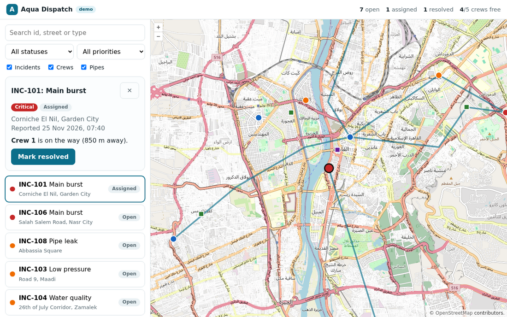

# Aqua Dispatch: water utility incident map

A demo dispatch map for a water utility. Operators see incidents (leaks, bursts, low pressure, water quality) on a map, pick one, and assign the nearest free crew. It mirrors the kind of GIS interface I build at work, with invented data.

**Live demo:** _add link after deploy_



## What it does

- **Map (OpenLayers 10)** with OpenStreetMap tiles, incident markers coloured by priority, crew markers (free or busy) and a pipe network layer. Layers can be switched on and off.
- **Incident list** sorted by urgency, with search and status/priority filters. Click a row or a marker to select it; the map centres on it.
- **Nearest-crew assignment:** for an open incident the panel ranks free crews by distance with a rough drive-time estimate. Assign one, and the crew turns busy.
- **Resolve:** closing an incident frees its crew at the incident's location.
- **Phone friendly:** the map goes on top and the list below on small screens.

## How it works

- **Geo maths is plain, tested code** (`src/lib/geo.js`): haversine distance on a sphere, not straight-line degrees, which would be wrong because a degree of longitude is shorter than a degree of latitude at Cairo's latitude.
- **Coordinates are `[longitude, latitude]` everywhere** in my data and are converted to the map projection (Web Mercator) only at the edge, in the map component. Mixing the two orders is the classic GIS bug, so there is one rule.
- **Dispatch rules live outside the UI** (`src/lib/incidents.js`): only open incidents can be assigned, only free crews can be chosen, only assigned incidents can be resolved. Invalid moves return `null` and change nothing. 15 tests cover this and the distance code.
- **The map is created once.** Marker data is redrawn when state changes; selecting only restyles. Event handlers read the latest props through refs so the map is not rebuilt on every click.
- **React + Vite + OpenLayers, no wrapper library.**

## Tradeoffs and what I would do next

- **All data is invented.** Locations are real Cairo districts, but incidents, crews and pipes are made up. State is kept in localStorage only.
- **ETA is a straight-line distance at 25 km/h**, not routing. A real version would call a routing service (for example OSRM or Mapbox Directions) for road distance and traffic.
- **Pipes are a handful of simplified lines.** A real network comes from a GIS database (PostGIS or ArcGIS) served as vector tiles or WFS, with valves and attributes.
- **OpenStreetMap's public tile server is for light use.** A production app uses a paid or self-hosted tile source.
- **No live updates.** Next: simulated crew movement, a time filter, marker clustering for large numbers of incidents, and component tests.

## Run it locally

```bash
npm install
npm run dev      # http://localhost:5173
npm test         # 15 tests on src/lib
npm run build
```

## Structure

```
src/
  components/   MapView (OpenLayers), IncidentPanel
  hooks/        useDispatch (state + localStorage)
  lib/          geo, incidents (+ tests)
  data/         invented seed data
```
