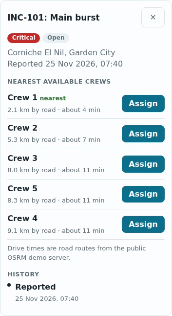

# Aqua Dispatch: water utility incident map

A demo dispatch map for a water utility. Operators see incidents (leaks, bursts, low pressure, water quality) on a map, pick one, and assign the nearest free crew. It mirrors the kind of GIS interface I build at work, with invented data.

**Live demo:** https://aqua-dispatch-hazel.vercel.app




## What it does

- **Map (OpenLayers 10)** with OpenStreetMap tiles, incident markers coloured by priority, crew markers (free or busy) and a pipe network layer. Layers can be switched on and off.
- **Incident list** sorted by urgency, with search and status/priority filters. Click a row or a marker to select it; the map centres on it.
- **Nearest-crew assignment with road times:** for an open incident the panel ranks free crews by travel time from the public OSRM routing server, with road distance and drive time for each. If routing is unavailable the list falls back to straight-line estimates, labelled as such. Assign one, and the crew turns busy.
- **Resolve:** closing an incident frees its crew at the incident's location.
- **Incident history:** every incident carries a timeline (reported, crew assigned, resolved, operator notes) that grows as you work it. Incidents saved by an older version of the app get their report entry back on load.
- **Phone friendly:** the map goes on top and the list below on small screens.

## How it works

- **Geo maths is plain, tested code** (`src/lib/geo.js`): haversine distance on a sphere, not straight-line degrees, which would be wrong because a degree of longitude is shorter than a degree of latitude at Cairo's latitude.
- **Coordinates are `[longitude, latitude]` everywhere** in my data and are converted to the map projection (Web Mercator) only at the edge, in the map component. Mixing the two orders is the classic GIS bug, so there is one rule.
- **Dispatch rules live outside the UI** (`src/lib/incidents.js`): only open incidents can be assigned, only free crews can be chosen, only assigned incidents can be resolved. Invalid moves return `null` and change nothing, and each one appends to the incident's history. 26 tests cover the dispatch rules, the distance code, the routing parser and the timeline helpers.
- **Routing is one request per incident** (`src/lib/routing.js`): the OSRM `/table` endpoint takes the incident as its only source and every free crew as a destination, so opening an incident costs a single call rather than one per crew. The response is parsed into one leg per crew; a crew with no road route keeps the straight-line estimate, and a failed or slow request returns `null` so the panel shows the fallback with its own label instead of an invented number.
- **The map is created once.** Marker data is redrawn when state changes; selecting only restyles. Event handlers read the latest props through refs so the map is not rebuilt on every click.
- **React + Vite + OpenLayers, no wrapper library.**

## Tradeoffs and what I would do next

- **All data is invented.** Locations are real Cairo districts, but incidents, crews and pipes are made up. State is kept in localStorage only.
- **Road times come from OSRM's public demo server** (`router.project-osrm.org`): free, no key, and meant for light use, with no traffic data and no rate-limit guarantee. A production version would run its own OSRM instance or pay for a directions service, and add traffic. The straight-line estimate at 25 km/h stays in the code as the fallback, and the panel always says which of the two it is showing.
- **Pipes are a handful of simplified lines.** A real network comes from a GIS database (PostGIS or ArcGIS) served as vector tiles or WFS, with valves and attributes.
- **OpenStreetMap's public tile server is for light use.** A production app uses a paid or self-hosted tile source.
- **No live updates.** Next: simulated crew movement along the routed line, a time filter on the history, marker clustering for large numbers of incidents, and component tests.

## Run it locally

```bash
npm install
npm run dev      # http://localhost:5173
npm test         # 26 tests on src/lib
npm run build
```

## Structure

```
src/
  components/   MapView (OpenLayers), IncidentPanel, IncidentTimeline
  hooks/        useDispatch (state + localStorage), useRoadEta (routing request)
  lib/          geo, incidents, routing (+ tests)
  data/         invented seed data
```
